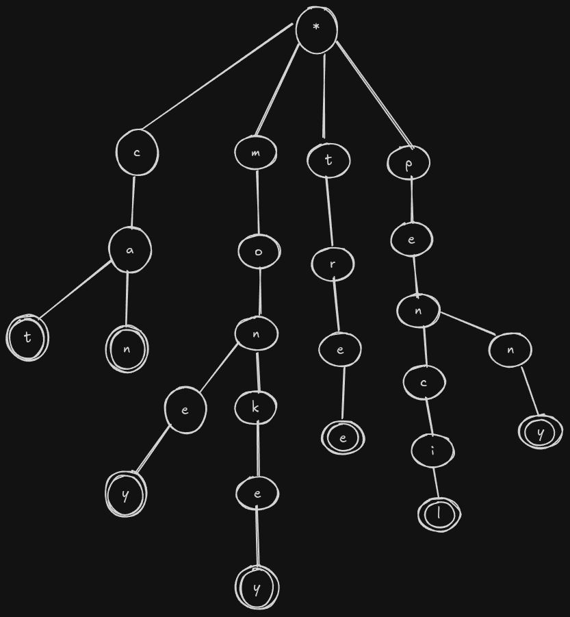

# Trie
## Integrantes
1. [Num cuenta ] [Nombre]
2. [Num cuenta ] [Nombre]
3. [Num cuenta ] [Nombre]
4. [Num cuenta ] [Nombre]
   
## Objetivo 

## Concepto 

## Contexto 
### Antecedentes 
### Desarrollo 
### Actualidad 

## Teoría 
### Paso a paso teórico 

## Demostración (Ejemplos de resultados)
Primero formaremos un trie secillo (sin code), con las letras del abecedario inglés $\sum = {a,b,c,...,y,z}$
Lo formaremos con las siguientes palabras: [can,monkey,tree,cat,money,pencil,penny]

## Análisis de resultados

## Conclusiones

## Referencias 
